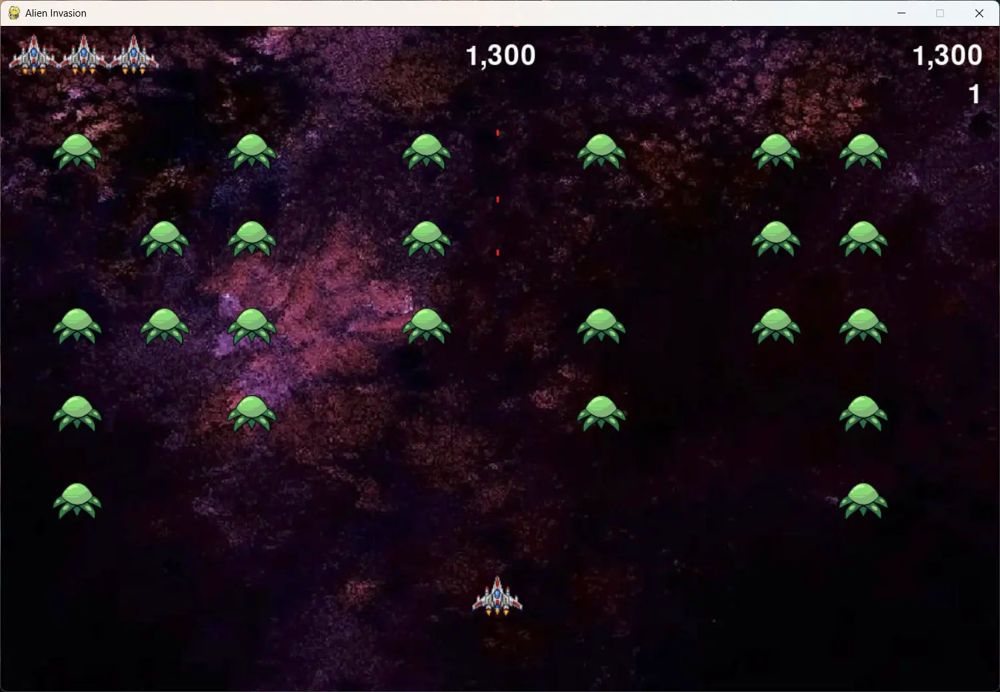

# B.R.A.N.D.O.N.

### Brutal Retaliation Against Nefarious Descending Orbital Nuisances

> **STATUS: ACTIVE.** Earth remains defended. Aliens remain annoyed.

B.R.A.N.D.O.N. is the planet's last line of defense against waves of descending alien invaders. One pilot. One ship. Three lives. Zero chance the aliens get past the bottom of your screen on your watch.

In civilian terms, it is a 2D arcade shooter built with Python and Pygame, inspired by my favorite arcade game, **Galaga**. The name is a tribute to the gloriously over-the-top acronyms of the Bloons TD 6 paragon towers (looking at you, B.O.M.B. and S.P.I.D.E.R.). Despite the naming, it is not a tower defense game.



## Mission Briefing

Hostile fleets descend from the top of the screen, sweeping side to side and dropping closer with every pass. Shoot them all down and a new fleet arrives, faster than the last. If an alien touches your ship or reaches the bottom of the screen, you lose a ship. Lose all three and the invasion succeeds.

Your goal: survive as many waves as you can and set a new high score.

## Pilot Controls

| Action | Key |
| ------ | --- |
| Move left / right | Left and Right arrow keys, or A and D |
| Move up / down | Up and Down arrow keys, or W and S |
| Fire | Spacebar |
| Quit | Q |

Hold a key for continuous movement. Your ship keeps flying until you let go.

## Threat Assessment

- Fleets of aliens that move across and down the screen
- Escalating difficulty, with each new fleet moving faster than the last
- Three ships per mission, and the game ends when they are gone
- Live scoreboard with a high score tracked during your play session
- Full four-direction ship movement, closer to the Galaga experience
- Custom-designed ship and alien artwork
- Full-screen space background that scales to fit the window without warping

## Field Modifications

This project follows the Alien Invasion project from *Python Crash Course* by Eric Matthes. The book provided the foundation. Everything below is what I added or changed to make it my own.

- **Custom ship designs.** I replaced the default images with ships I designed from scratch. I planned and brainstormed them, built them as vector art in Adobe Illustrator, refined them, resized them, and exported them as PNGs for the game.
- **Four-direction movement.** The book's ship only moves left and right. I extended the movement logic so the ship can also move up and down.
- **Left-handed pilot support.** I added WASD controls alongside the arrow keys, because defending Earth should not depend on which hand you write with.
- **Scalable space background.** I added a background that crops to the window instead of stretching, which meant removing the old background fill from the scoreboard text so it stayed readable and clean. The background is a nod to one of my favorite cartoons, *Regular Show*.
- **Rebalanced difficulty.** I slowed the game down, though not by much, so players can last longer and chase a higher score.
- **More breathing room.** I removed one row from the starting alien fleet to give the player more space to maneuver.

## Challenges

- **Press vs. hold.** Getting smooth, continuous movement from a held key instead of a single press took some real thought about how keyboard events work.
- **Finding the difficulty sweet spot.** Both the starting speed and the speed increase per level needed repeated testing and tuning.
- **Background scaling.** Making the background crop to the window instead of warping it required handling the image size separately from the screen size.
- **Up and down movement.** I had to repeat and adapt the movement mechanics for a second axis.
- **Designing custom ships.** Going from sketch to Illustrator to an in-game sprite that looked right at the right size was a full pipeline of its own.

## Deploy Locally

You will need Python 3 and Pygame.

1. Clone the repository:
   ```bash
   git clone https://github.com/brandsharky/BRANDON.git
   cd BRANDON
   ```
2. Install Pygame:
   ```bash
   pip install pygame
   ```
3. Launch the mission:
   ```bash
   python alien_invasion.py
   ```

## Built With

- Python
- Pygame
- Adobe Illustrator (custom ship artwork)

## Classified Disclosure (The Boring but Honest Part)

Earth has not actually been invaded, and I am not actually a planetary defense contractor. Here is the real credit:

- The core game is based on the Alien Invasion project in *Python Crash Course* by Eric Matthes. I built it by following the book, then extended it with the changes listed above.
- The space background is inspired by the cartoon *Regular Show* and is included as a personal fan touch. It belongs to its original creators.
- The high score is tracked during a single play session and resets when the game is closed.

## Author

Brandon Arroyo ([@brandsharky](https://github.com/brandsharky)), Pilot, Engineer, and Self-Appointed Defender of Earth.
